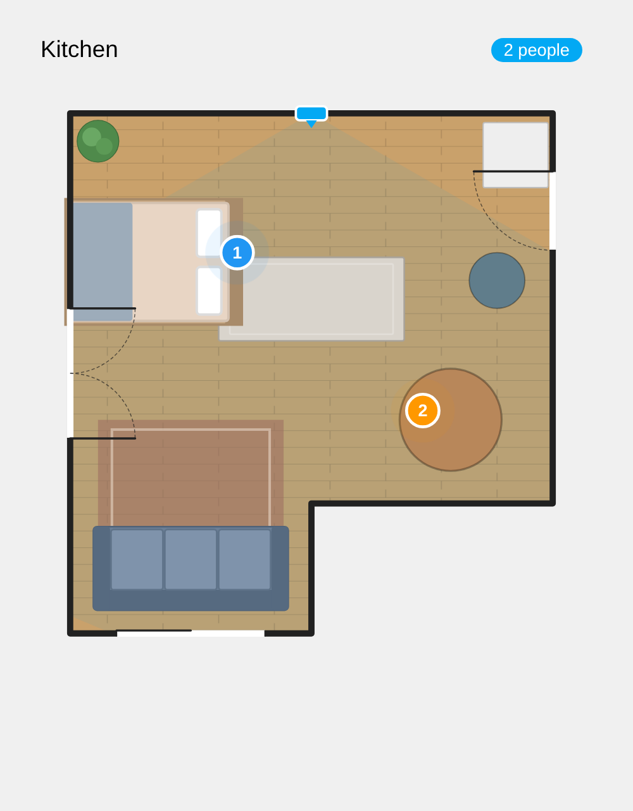

# Everything Presence Floor Plan Card

A Home Assistant dashboard card that shows a room you built in the
**Everything Presence Zone Configurator** add-on, with the live position of
everyone the sensor is tracking.



It draws the walls, floor, furniture, doors, sensor and (optionally) zones from
the add-on, then moves a dot for each person as Home Assistant reports new
target X/Y values. Works with Everything Presence Lite and Everything Presence
Pro (the models that report target positions).

## How it works

- **Layout** is read from the add-on's own API through Home Assistant ingress,
  the same way the add-on's sidebar panel loads. The card refreshes it every
  five minutes, so edits you make in the add-on show up on their own.
- **People** come straight from the sensor's `target_N_x` / `target_N_y`
  entities, so the dots move as fast as Home Assistant pushes state changes.
  The card uses the add-on's entity mapping when it has one, then the device's
  entities, so renamed entities still work.
- The sensor's installation angle is applied, using the same maths as the
  add-on's live view.

## Install

### HACS (recommended)

1. HACS → ⋮ → **Custom repositories** → add
   `https://github.com/chris-standley/everything-presence-floorplan-card`
   with type **Dashboard**.
2. Install **Everything Presence Floor Plan Card** and reload the browser.

### Manual

Copy `everything-presence-floorplan-card.js` to `/config/www/`, then add it
under **Settings → Dashboards → ⋮ → Resources** as
`/local/everything-presence-floorplan-card.js` (JavaScript module).

## Use

Add the card from the card picker (search "Everything Presence"), or in YAML:

```yaml
type: custom:everything-presence-floorplan-card
room: Kitchen
```

| Option | Default | What it does |
| --- | --- | --- |
| `room` | add-on's default room | Room name or id, as named in the add-on |
| `title` | room name | Header text. `false` hides the title |
| `show_header` | `true` | Show the title and the people count |
| `show_status` | `true` | Show the "2 people" / "Clear" chip |
| `show_furniture` | `true` | Draw furniture |
| `show_doors` | `true` | Draw doors |
| `show_device` | `true` | Draw the sensor |
| `show_coverage` | `true` | Shade the sensor's field of view |
| `show_zones` | `false` | Draw the rectangular zones saved in the room |
| `show_target_labels` | `true` | Number each person |
| `trail_seconds` | `0` | Draw a fading movement trail this many seconds long |
| `target_size` | `350` | Person dot diameter in mm |
| `target_color` | per person | One colour for every person, for example `"#e91e63"` |
| `max_height` | none | Cap the card's height, in px (number) or any CSS length |
| `refresh_interval` | `300` | Seconds between layout refreshes. `0` turns it off |
| `addon_slug` | auto | The add-on's slug, if auto-detection fails |
| `targets` | auto | List of `{x, y, active}` entity ids to use instead |
| `installation_angle_entity` | auto | Entity holding the sensor's installation angle |
| `installation_angle` | from entity | Fixed angle in degrees, overrides the entity |
| `presence_entity` | auto | Occupancy sensor for the "Occupied" chip |
| `room_url` | none | Load the room from this URL instead of the add-on |
| `room_config` | none | A room object pasted straight into the card config |

## Non-admin users and wall tablets

Opening add-on ingress normally needs an admin user. If the card can't reach
the add-on on a non-admin account, it reuses the last layout it loaded in that browser, so loading
the dashboard once as an admin on the tablet is usually enough. If that isn't
possible, copy the add-on's
`/config/everything-presence-zone-configurator/rooms.json` to
`/config/www/` and set `room_url: /local/rooms.json`. Files under `/local`
are readable without logging in, so only do this if you're happy for the
floor plan to be public on your network.

## Credits

Built on the data model of the
[Everything Presence add-on](https://github.com/EverythingSmartHome/everything-presence-addons)
by Everything Smart Home. This card is not affiliated with them.
